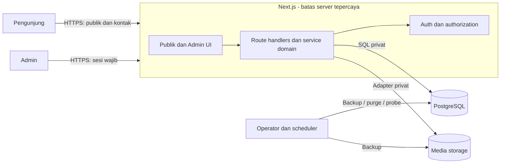
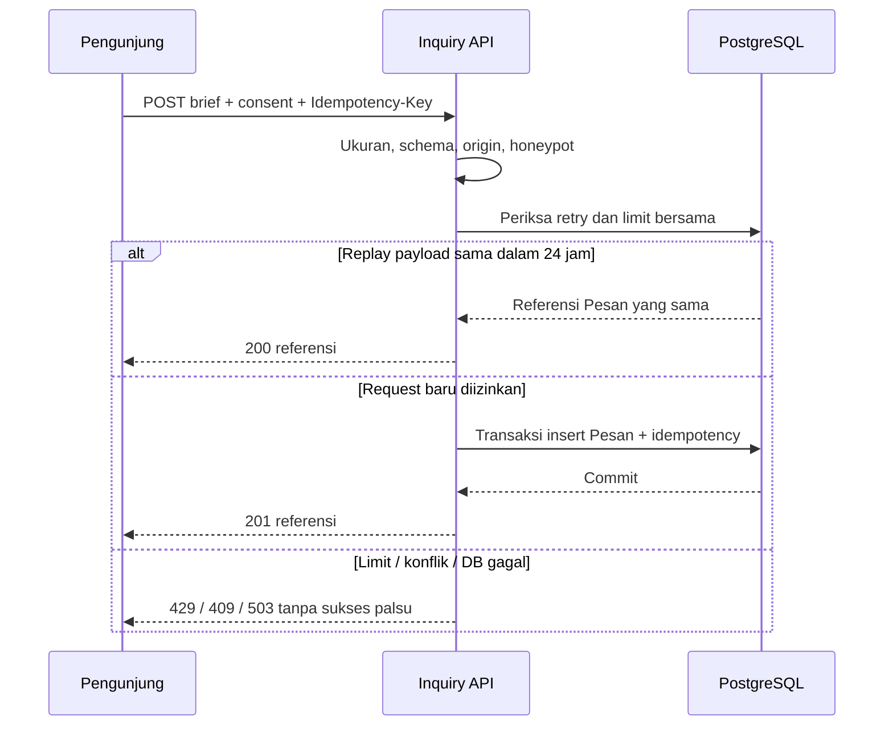
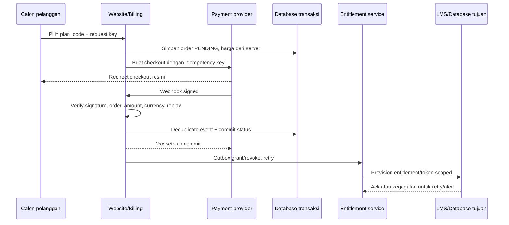

# Design — MasterCAD Full Stack

## 1. Ringkasan dan batas desain

Desain mengikuti [PRD.md](PRD.md) dan glosariumnya. Implementasi lokal menggunakan monolit modular **Next.js App Router + TypeScript**, CSS variables, **SQLite persisten melalui `node:sqlite`**, **Better Auth**, dan filesystem media privat. Frontend publik, admin, serta API berada dalam satu aplikasi. Versi dependensi dipin di package.json dan package-lock.json; setup, migrasi auth/domain, typecheck, tes dan build telah dijalankan. PostgreSQL tetap opsi produksi, belum diterapkan atau diuji.

**§17 adalah kontrak implementasi lokal yang aktual.** §4–§12 memuat target produksi awal yang belum seluruhnya dipenuhi (PostgreSQL, adapter storage, scheduler, CI, monitoring, metrik). Perbedaan API, data dan operasi dirangkum di §17 agar target tidak dibaca sebagai fitur yang sudah berjalan.

Pilihan monolit mengurangi deployment terpisah sambil menjaga batas server, data pribadi, dan media privat. Konfigurasi statis lama tidak cukup menjadi bukti kesiapan full stack. Hosting aktual dan adapter media diputuskan setelah spike M0; database tidak pernah diakses langsung dari browser.

## 2. Pemetaan requirement ke desain

| Requirement | Respons desain | Komponen/keputusan | Verifikasi |
|---|---|---|---|
| FR-01 | Halaman server membaca snapshot Published | C-PUBLIC, C-CONTENT; §3/§6 | AC-01 |
| FR-02 | Filter kategori, slug publik, label jenis | C-PUBLIC, C-CONTENT; §3/§6 | AC-02 |
| FR-03 | Validasi, limit, idempotency, insert atomik | C-INQUIRY; §5/§7 | AC-03 |
| FR-04 | Better Auth + cek Admin aktif dekat data | C-AUTH; ADR-002, §8 | AC-04 |
| FR-05 | Draft terpisah dari snapshot publik; version check | C-CONTENT; §6/§7 | AC-05 |
| FR-06 | Editor karya, publish, media privat | C-CONTENT, C-MEDIA; ADR-003 | AC-06 |
| FR-07 | Kotak masuk dengan transisi/hapus atomik | C-INQUIRY; §6/§7 | AC-07 |
| FR-08 | Metadata/sitemap/noindex/404 | C-PUBLIC; §3/§9 | AC-08 |
| FR-09 | Pengaturan publik terpilih, tanpa secrets | C-CONTENT; §6/§7 | AC-09 |
| FR-19 | Beranda mempromosikan Autodesk License dan Engineering Design CAD; CTA WA memakai nomor dari pengaturan, jika kosong fallback ke `/kontak` | C-PUBLIC/C-CONTENT; §3 | AC-19 |
| FR-10 | Publikasikan paket dan aturan renewal dari sumber server | C-BILLING; §18 | AC-10 |
| FR-11 | Buat checkout pending untuk periode bulanan/tahunan | C-BILLING/C-AUTH; §18 | AC-11 |
| FR-12 | Verifikasi dan rekonsiliasi callback pembayaran secara idempotent | C-BILLING/C-OPS; §18 | AC-12 |
| FR-13 | Berikan akses modul hanya untuk entitlement aktif | C-ENTITLEMENT/C-AUTH; §18 | AC-13 |
| FR-14 | Tampilkan status dan renewal pelanggan | C-MEMBER; §18 | AC-14 |
| FR-15 | Operasi pelanggan dan perubahan manual teraudit | C-BILLING/C-OPS; §18 | AC-15 |
| FR-16 | Lesson dan progres pelanggan tersimpan | C-LMS/C-ENTITLEMENT; §18 | AC-16 |
| FR-17 | Katalog/unduhan Database sesuai hak aktif | C-DATABASE/C-MEDIA/C-ENTITLEMENT; §18 | AC-17 |
| FR-18 | Admin mengelola konten kedua produk | C-LMS/C-DATABASE; §18 | AC-18 |
| NFR-01 | Origin/session, parameterized SQL, upload checks | C-AUTH, C-MEDIA, C-INQUIRY; §8 | Negatif akses/CSRF/SQL/file |
| NFR-02 | Minimisasi, redaction, purge, deletion ledger | C-INQUIRY, C-OPS; §6/§8 | Purge/restore/log |
| NFR-03 | Tokens kontras, semantic UI, keyboard | C-PUBLIC, C-ADMIN; §3 | Axe + manual |
| NFR-04 | SSR, ukuran gambar, indeks, batas pool | C-PUBLIC, C-DB; §9 | Lab/load |
| NFR-05 | Transaksi, timeout, backup DB+media | C-INQUIRY, C-OPS; §9/§12 | Failure/restore |
| NFR-06 | Request ID, log aman, probe/alarm | C-OPS; §10 | Log/alert drill |
| NFR-07 | Modul/domain, SQL migrations, lockfile/CI | C-DB, C-OPS; §4/§12 | CI/migrasi |
| NFR-08 | Responsive dan browser matrix | C-PUBLIC, C-ADMIN; §3/§11 | Browser/mobile |
| NFR-09 | Signature, replay, nominal, secret dan idempotency pembayaran | C-BILLING; §18 | Sandbox contract/replay |
| NFR-10 | Rekonsiliasi status dan grant/revoke entitlement maksimal 5 menit | C-BILLING/C-ENTITLEMENT/C-OPS; §18 | Retry/reconcile/failure drill |
| NFR-11 | Minimisasi data akun/transaksi dan token modul scoped/pendek | C-AUTH/C-ENTITLEMENT; §18 | Privacy/token review |
| NFR-12 | Video/materi/file privat, grant dan signed access berumur pendek | C-LMS/C-DATABASE/C-MEDIA; §18 | Direct URL/revoke/expiry |

## 3. Desain UI/UX

### 3.1 Arah visual

Revisi visual 13 Oktober 2026 setelah pengguna menilai tampilan sebelumnya tidak sesuai: arah aktif menjadi **editorial engineering yang terang**, dengan kanvas warm-white, teks charcoal, aksen amber dan foto mekanikal yang jelas terpisah dari copy hero. Header memakai logo gelap. Foto diberi bingkai lembut dan caption Studi Konsep; tidak ada logo pelanggan, statistik, atau klaim kemitraan yang belum dikonfirmasi.

Beranda memakai dua kolom pada hero, strip empat kemampuan, daftar layanan editorial tanpa deretan kartu berulang, dua panel kontras untuk Autodesk License dan Engineering Design CAD, bagian studio charcoal, karya unggulan besar, langkah kerja, FAQ native `details` dan CTA amber. Implementasi berada di `src/app/(public)/page.tsx` dan `src/app/home-redesign.css`; halaman paket tetap memakai stylesheet sebelumnya. Semua layanan, setting, FAQ, proses, serta karya Published terus dibaca dari CMS dan CTA kontak resmi tetap mengikuti pengaturan.

Palet lama charcoal/amber tetap menjadi aksen untuk bagian studio dan footer. Halaman sekunder/admin tidak berubah; auth, inbox, dan media tetap melalui backend yang sama. Screenshot `custom-redesign.md` merupakan riwayat desain lama, bukan bukti visual revisi ini.

| Token | Nilai usulan | Penggunaan |
|---|---|---|
| `--brand` | `#FFBF00` | CTA utama dengan teks `#171717`; bukan teks kecil pada putih |
| `--accent` | `#765600` | Teks aksen pada latar putih; verifikasi kontras |
| `--ink` / `--muted` | `#17191C` / `#5C6168` | Heading/body dan teks sekunder |
| `--surface` / `--canvas` | `#FFFFFF` / `#F2F0E9` | Surface utama dan kanvas warm-white landing |
| `--line` | `#D9DDE0` | Pemisah dekoratif; batas input memakai `#7A838D` |
| Spasi | 4, 8, 12, 16, 24, 32, 48, 64 px | Skala konsisten |
| Radius | Landing: tombol 5 px, media/panel 10 px; admin 4 px | Foto hero berbingkai lembut; hierarki panel terarah |
| Typography | System sans; body ≥16 px, line-height 1,6 | Tanpa dependensi font eksternal MVP |
| Lebar | Maksimum 1280 px; gutter responsif 20–48 px | Mobile/tablet/desktop |

Responsif: satu kolom <768 px; dua kolom 768–1023 px; hingga tiga kolom ≥1024 px. Target sentuh 44 px, fokus terlihat, heading berurutan, skip link, alt text, reduced motion. Informasi status selalu memakai teks/ikon selain warna. Tidak membuat dashboard statistik bisnis fiktif; angka dashboard berasal dari database.

### 3.2 Peta halaman

| Route | Isi dan tindakan |
|---|---|
| `/` | Header, hero + CTA Konsultasi, layanan ringkas, karya unggulan, proses, FAQ, CTA/footer |
| `/tentang` | Profil terverifikasi; tanpa angka/testimoni buatan |
| `/layanan`, `/layanan/[slug]` | Daftar, lingkup, deliverable, proses, CTA |
| `/portofolio`, `/portofolio/[slug]` | Filter kategori, kartu, galeri, deskripsi, label PROJECT/CONCEPT |
| `/kontak` | Form dan kontak resmi; pemberitahuan penggunaan data |
| `/privasi` | Tujuan, retensi, kontak penghapusan, penyedia setelah dipilih |
| `/admin/login` | Email/password, error generik |
| `/admin` | Ringkasan pesan NEW, shortcut edit konten/karya |
| `/admin/konten` | Profil, layanan, proses, FAQ; editor terstruktur dan urutan |
| `/admin/portofolio` | Daftar status, tambah/edit, gallery, preview, publish/arsip |
| `/admin/media` | Daftar media, upload, referensi pemakaian, hapus yang tidak terpakai |
| `/admin/pesan` | Filter status, pagination, detail privat, perubahan status/hapus |
| `/admin/pengaturan` | Identitas, kontak, SEO default; tanpa kredensial |
| `/admin/preview/[id]` | Preview draft dengan sesi Admin; no-store/noindex |

### 3.3 State interaksi

Loading memakai skeleton sederhana; empty state menerangkan cara mengisi/hasil filter kosong. Error form terhubung ke field dan ringkasan fokus. Submit menonaktifkan tombol selama request; sukses menampilkan kode referensi hanya setelah insert DB. Kegagalan mempertahankan input. Login invalid tidak membocorkan keberadaan email. Sesi habis meminta login tanpa mengeksekusi mutasi. Editor memperingatkan perubahan belum disimpan; konflik versi menawarkan reload, bukan overwrite. Publish/unpublish dan hapus menggunakan konfirmasi yang menjelaskan dampak. Tidak menyimpan brief publik ke localStorage atau analytics.

## 4. Konteks sistem dan komponen

Semua jalur data privat melalui server; operator punya izin operasi terpisah dari Pengunjung.

| ID | Komponen | Tanggung jawab / data | Antarmuka / kegagalan |
|---|---|---|---|
| C-PUBLIC | UI publik | Render snapshot Published dan metadata | Server render; konten gagal dibaca → error/503 |
| C-ADMIN | UI admin | Editor, preview, inbox | API same-origin; sesi habis → login |
| C-AUTH | Auth/authorization | Akun, sesi, Admin aktif | Better Auth + guard data; fail closed |
| C-CONTENT | Content service | Konten, Portofolio, pengaturan, publish | Query parameterized; transaksi/version guard |
| C-INQUIRY | Inquiry service | Pesan, consent, dedupe, limit | POST publik + API admin; transaksi |
| C-MEDIA | Media service | Metadata, original privat, image variants | Adapter storage; validasi/re-encode; no anonymous draft |
| C-DB | Database/repositories | Schema, constraints, query, migrations | Pool node-postgres; timeout dan health |
| C-OPS | Operations | Audit aman, backup, purge, probes | Scheduler/operator; alarm kegagalan |
| C-BILLING | Billing adapter | Paket, order, callback/event pembayaran, rekonsiliasi | Adapter server-only ke Xendit; signature/timeout/retry; merchant onboarding pending |
| C-MEMBER | Member portal | Paket, checkout, status langganan | UI akun server-rendered; pelanggan login |
| C-ENTITLEMENT | Entitlement gateway | Hak akses per modul dan periode berlaku | Cek server-side; grant/revoke ke LMS/Database lewat protokol yang diverifikasi |
| C-LMS | Learning service | Course, module, lesson, materi dan progres | Server auth; konten kosong sampai Admin membuat course |
| C-DATABASE | CAD resource catalog | Item, kategori, metadata, search/filter dan unduhan | Query terotorisasi; file privat; rate/kuota belum diputuskan |

Struktur usulan: `src/app/(public)/`, `src/app/admin/`, `src/app/akun/`, `src/app/paket/`, `src/app/lms/`, `src/app/database/`, `src/app/api/v1/`, `src/app/api/auth/`, `src/components/`, `src/modules/{content,portfolio,inquiry,media,billing,entitlement,lms,resource-catalog}/`, `src/lib/{auth,db,validation,observability}/`, `db/migrations/`, `scripts/`, `tests/`, `docs/`. Produksi merutekan host LMS/Database ke app yang sama; modul tetap memvalidasi entitlement server-side.

## 5. Alur kritis

Retry setelah timeout memakai kunci yang sama; setelah edit payload UI membuat kunci baru. Pemeriksaan rate limit bersifat atomik lintas proses. Replay tetap melewati limit umum untuk mencegah abuse; rate limit tidak dianggap pengganti autentikasi.

Publish: Admin → guard sesi/Admin aktif/origin → validasi versi dan kelengkapan → transaksi memperbarui snapshot Published dan audit → commit → publik membaca snapshot baru. Mengedit Draft karya Published tidak mengubah snapshot publik. Unpublish menghapus snapshot publik; pembacaan media memeriksa snapshot aktif. Gagal commit tidak menampilkan publish sukses.

## 6. Model data dan siklus hidup

Semua waktu disimpan UTC; tampilan admin memakai Asia/Makassar. ID domain UUID acak; kode referensi Pesan tidak dapat dipakai publik untuk membaca detail.

| Entitas | Kolom/aturan utama |
|---|---|
| Auth user/account/session/verification | Schema milik Better Auth, dibuat lewat migrasi library kompatibel; bukan password buatan sendiri |
| AdminProfile | user_id FK unique, active boolean; setiap request admin memeriksa active di DB |
| ContentItem | id, type PAGE/SERVICE/PROCESS/FAQ, slug unique per type, draft_payload, published_payload nullable, status, version, sort_order, published_at, created_at, updated_at |
| Portfolio | id, slug unique, draft_payload, published_payload nullable, status, version, category_id, timestamps; payload punya title, description, kind, gallery dan izin |
| Category | id, name, slug unique; dipakai karya Published/Draft; penghapusan kategori terpakai ditolak |
| Media | id, storage_key opaque unique, mime, bytes, width/height, checksum, created_by, created_at; metadata tanpa URL privat permanen |
| MediaReference | media_id, owner_type, owner_id, scope DRAFT/PUBLISHED, sort_order, alt_text; sinkron atomik saat save/publish; media yang dirujuk tidak dihapus |
| Inquiry | id, reference unique, name, email, phone?, company?, service_id? nullable, message, consent_at, notice_version, status, created_at, updated_at |
| IdempotencyRecord | key_hash unique, payload_hmac, inquiry_id, expires_at; 24 jam; tidak menyimpan payload mentah |
| RateLimitBucket | opaque subject hash + route + window unique, count, expires_at; increment atomik; TTL ≤24 jam |
| SiteSettings | singleton, draft_payload, published_payload, version; field publik dipilih allowlist |
| AuditEvent | actor_id?, action, entity_type, entity_id, request_id, timestamp; tanpa brief/password atau salinan PII |
| DeletionLedger | entity_id, deleted_at, expires_at; tanpa PII; retensi 31 hari untuk backup maksimum 30 hari |

Invarian: `published_payload` berisi salinan lengkap terakhir yang diterbitkan; Draft dan Published tidak berbagi objek mutable. Status Published mewajibkan payload publik. Archived tidak punya snapshot publik. Satu karya memiliki kategori; satu media dapat dipakai beberapa Konten/Portofolio. `MediaReference` memakai scope sehingga pergantian gambar Draft tidak membocorkan aset baru. Service memvalidasi referensi polymorphic dalam transaksi, karena FK ke beberapa tabel tidak otomatis menjamin relasi.

Indeks: `(status, sort_order)` Konten; `(status, category_id, published_at)` Portofolio; `(status, created_at, id)` Pesan; unique slug, key idempotency, storage key; expiry untuk purge. Query publik selalu menyeleksi snapshot saja; Pesan/Auth tidak masuk DTO publik. service_id pada Pesan memakai FK nullable ON DELETE SET NULL; brief tidak hilang ketika layanan diarsipkan.

Input berupa teks dan struktur terbatas, bukan HTML bebas; render melakukan escaping. SQL migrations berurutan, migrasi library auth di-review dan disimpan; seed lokal berlabel CONCEPT, tanpa akun/password default produksi.

Purge harian menghapus Pesan >180 hari dan ledger mencatat ID; penghapusan admin melakukan keduanya dalam transaksi. Idempotency terkait ikut dibersihkan. Log 14 hari, audit 90 hari. Cleanup media tanpa referensi >7 hari; orphan upload ditangani bila penyimpanan sukses tetapi insert DB gagal. Backup DB+media terenkripsi harian, 30 hari; restore isolated lalu replay ledger yang disimpan terpisah sebelum trafik dibuka. RPO/RTO dibuktikan, bukan asumsi dari backup terjadwal saja.

## 7. Kontrak API

API domain memakai `/api/v1`; JSON UTF-8, request ID pada respons. Body kontak/admin teks maksimal 16 KB; pagination cursor maksimal 50 item, default 20. Error `{error:{code,message,fields?},requestId}` tanpa stack/SQL. DTO publik membatasi field Published; response admin/auth/contact `Cache-Control: no-store`. CORS same-origin. API auth library berada di `/api/auth/*` dan tidak diduplikasi.

| Route/metode | Akses | Request | Respons / error / konsistensi |
|---|---|---|---|
| `GET /content/:type/:slug` | Publik | Type allowlist, slug | 200 snapshot; 404 draft/hilang; 503 DB |
| `GET /portfolio` | Publik | category?, cursor?, limit? | 200 `{items,nextCursor}` Published; 422 query invalid |
| `GET /portfolio/:slug` | Publik | Slug | 200 snapshot/404; no-store untuk batas publikasi |
| `POST /inquiries` | Publik | Form + Idempotency-Key UUID | 201 `{reference}`, replay 200; 409/422/429/503 |
| `GET /admin/content`, `/admin/portfolio` | Admin | Status/cursor | 200 draft + snapshot + version; 401/403 |
| `POST /admin/content`, `/admin/portfolio` | Admin | Payload terstruktur | 201 id/version; 409 slug duplikat; 422 invalid |
| `PATCH /admin/content/:id`, `/admin/portfolio/:id` | Admin | expectedVersion + draft fields | 200 versi baru; 409 stale; 404 hilang |
| `POST /admin/:resource/:id/publish` | Admin | expectedVersion | 200 Published; 409 stale/422 belum lengkap |
| `POST /admin/:resource/:id/archive` | Admin | expectedVersion | 200 Archived; publik 404; 409 stale |
| `POST /admin/:resource/:id/unpublish` | Admin | expectedVersion | 200 Draft tanpa snapshot; 409 stale |
| `GET/POST/PATCH /admin/categories` | Admin | id? name/slug/version | Daftar/create/edit; duplicate 409; tidak ada delete kategori terpakai |
| `GET /admin/media` | Admin | Cursor | 200 metadata + referensi; tanpa storage secret |
| `POST /admin/media` | Admin | Multipart gambar ≤5 MB | 201 id/metadata; 413/415/422/503 |
| `DELETE /admin/media/:id` | Admin | expectedVersion bila diterapkan | 204; 409 masih dipakai; 404 hilang |
| `GET /media/:id` | Publik jika dirujuk Published; lainnya Admin | id, variant allowlist | Stream variant saja; 404 privat/tidak ada; no-store; original hanya Admin |
| `GET /admin/inquiries`, `/:id` | Admin | Status/cursor / UUID | 200 inbox/detail; 404 hilang; tidak tersedia endpoint baca publik |
| `PATCH /admin/inquiries/:id` | Admin | status + expectedUpdatedAt | 200; 409 konflik; 422 transisi invalid |
| `DELETE /admin/inquiries/:id` | Admin | Konfirmasi UI + expectedUpdatedAt | 204 + ledger; 409 stale; ulang delete 204 bila sudah hilang |
| `GET/PATCH /admin/settings` | Admin | Draft + expectedVersion | 200; 409 stale/422 invalid |
| `POST /admin/settings/publish` | Admin | expectedVersion | 200 snapshot aktif; 409 stale/422 |
| `GET /settings` | Publik | Tidak ada | Allowlist Published saja |
| `GET /health/live`, `/health/ready` | Liveness publik; readiness monitor | Token operator untuk ready | 200 hidup / 200 siap atau 503; tanpa detail DB |

`:resource` hanya `content` dan `portfolio`; implementasi tidak membentuk query/table dari string request. Editor pengaturan mengikuti aturan draft/publish yang sama dengan Konten.

Form: nama 2–100 karakter, email valid ≤254, brief 20–5000, perusahaan opsional ≤150, telepon opsional ≤30 karakter dengan format yang diizinkan, service_id opsional harus layanan Published. consent wajib `true`; timestamp dari server, versi pemberitahuan aktif dari server. Honeypot diisi → generic 422 tanpa insert; JSON unknown fields ditolak.

Idempotency: kunci random dibuat per percobaan logis; TTL 24 jam, unique constraint dan transaksi menjamin dua request concurrent tidak menggandakan. Payload HMAC mencakup field ternormalisasi; replay hanya untuk payload sama dan mengembalikan reference, tidak PII. Setelah TTL pesan baru boleh tercipta; UI menjelaskan bila pengguna sengaja mengirim lagi. Operasi admin tidak di-retry otomatis; PATCH memakai version guard, publish berulang menghasilkan keadaan sama atau konflik, bukan versi publik tak terkendali.

## 8. Keamanan dan privasi

- Better Auth email/password dengan registrasi publik disabled; operator membuat Admin pertama melalui skrip server sekali pakai dan prompt rahasia, tanpa default password. Password hashing dan sesi memakai library. Pemulihan MVP melalui operator terpercaya yang mencabut sesi; email reset otomatis fase lanjut.
- Usulan sesi: maksimum 8 jam tanpa perpanjangan otomatis; cookies Secure/HttpOnly/SameSite sesuai konfigurasi library. Cache sesi dimatikan pada pengecekan izin; AdminProfile aktif dibaca server tiap operasi. Logout mencabut sesi DB.
- Guard ada pada setiap route/mutasi/service privat, tidak bergantung pada hidden menu atau route middleware saja. CSRF/origin library untuk auth; mutasi domain memeriksa Origin terhadap APP_URL, cookie same-site, dan content type. Jangan membuka wildcard CORS.
- Limit usulan tersimpan PostgreSQL: kontak 5 request baru/15 menit per network hash + 3/email hash/jam; auth 5 gagal/15 menit per account/network + limit global; upload 20/15 menit/admin; edit 60/menit/admin. Hash identitas limit memakai HMAC secret dengan TTL. Hanya percaya IP header proxy yang dikonfigurasi. Limiter unavailable → 503 pada mutasi publik.
- Upload JPEG/PNG/WebP ≤5 MB dan ≤20 megapixel; periksa signature/decode, re-encode buang metadata EXIF, nama opaque, alt text wajib sebelum publish. Tolak SVG/GIF/HTML dan file CAD MVP. Batasi memory/time codec. Tidak menyajikan path file dari input.
- Media asli privat; adapter filesystem di luar public jika persistent runtime, atau object storage privat jika managed runtime. Akses variant melalui server yang memeriksa referensi Published/sesi. No-store dan tanpa CDN public permanen menjaga unpublish; ini menukar caching maksimal dengan kontrol akses. Data yang telah diunduh pihak lain tetap di luar kontrol server.
- Secrets hanya env server: DATABASE_URL, BETTER_AUTH_SECRET, APP_URL, RATE_LIMIT_HMAC_SECRET, IDEMPOTENCY_HMAC_SECRET, HEALTH_TOKEN, MEDIA_DRIVER dan konfigurasi privat storage. Tidak memakai prefix publik untuk rahasia; `.env.example` placeholder saja.
- Teks di-escape; query parameterized; CSP, nosniff, HTTPS/HSTS setelah domain siap, frame policy sesuai kebutuhan. Sanitasi URL kontak; audit action/ID tanpa payload. Privasi mengikuti retensi PRD; log request tidak mencatat body/query yang berisi PII.

## 9. Keandalan dan performa

Asumsi kapasitas awal 1.000 kunjungan/hari, 100 Pesan/hari, 200 karya, maksimum 6 gambar/karya, 1–3 Admin. Angka untuk sizing, bukan statistik perusahaan. Load test 10 req/detik kontak memakai IP/email unik agar tidak hanya mengukur respons 429; uji limit terpisah.

Halaman publik dirender server agar isi dan metadata tersedia. Awal MVP memakai pembacaan Published tanpa cache data konten/media; publikasi langsung konsisten setelah commit dan tidak mengandalkan invalidasi versi framework. Optimalkan aset build immutable, ukuran variant, lazy loading selain hero, dimensi gambar untuk CLS, pagination dan indeks. Ukur biaya DB/media sebelum menambahkan caching; caching masa depan harus tetap memenuhi unpublish ≤60 detik.

Query DB timeout usulan 3 detik; request kontak budget 5 detik; storage timeout 10 detik. Pool kecil sesuai batas provider dan total replika. Tidak retry mutasi otomatis server; klien retry kontak dengan kunci sama. Outage DB: kontak/admin 503, halaman yang memerlukan DB error terkontrol; jangan menampilkan konten draft atau sukses simpan palsu. Upload partial dibersihkan. Uptime target dipantau 30 hari; rollback aplikasi tidak membatalkan Pesan yang sudah commit.

## 10. Observability dan operasi

| Sinyal | Isi aman | Tindakan / pemilik |
|---|---|---|
| Request log | request_id, route template, status, duration; tanpa body/PII/token | Operator korelasikan error |
| Metrics | Kontak accepted/invalid/limited/error, latency, 5xx, upload failures | Alarm 5xx >5%/5 menit; operator |
| Auth audit | Hasil, waktu, ID akun bila dikenal; tanpa kredensial | Operator pantau burst gagal |
| Content audit | actor_id/action/entity_id/version/request_id | Admin/operator telusuri publikasi |
| Health | Liveness proses, readiness koneksi DB/storage | Uptime probe; alert gagal berturut-turut |
| Job status | Backup/purge mulai/selesai/durasi/hasil, tanpa data pribadi | Alert job gagal/tidak berjalan 26 jam |

Trace MVP berupa request ID sampai repository dan storage; distributed tracing tidak diperlukan karena satu aplikasi. Dashboard operasional merangkum metrik tersebut; runbook menjelaskan login terkunci, kontak gagal, media gagal, outage, backup/restore, purge, rollback dan rotasi secrets. Pengembang menyiapkan; operator menjalankan.

## 11. Strategi verifikasi

| Lapisan | Perilaku / risiko | Kapan |
|---|---|---|
| Unit | Validasi form, transisi status, mapping DTO, publish rules | Lokal/CI |
| Integrasi dengan PostgreSQL nyata | Auth guard, snapshot draft/publish, race dedupe, version conflict, limiter/purge | CI; bukan database mock saja |
| Kontrak API | DTO publik tidak berisi PII/draft, status/error/pagination | CI |
| E2E | Kontak → inbox; login → edit → publish; portfolio/media → unpublish; logout | Staging sebelum rilis |
| Keamanan | Anonim semua jalur admin, CSRF, upload palsu/besar, SQL injection, secret/log redaction | CI + staging |
| Aksesibilitas/browser | Axe + keyboard, kontras, states, 360/768/1440 px; dua rilis browser | Staging |
| Performa/recovery | Lighthouse, load nyata, DB outage, backup/restore DB+media, replay deletions | Gate rilis |

Tidak menambah tes yang hanya menyalin implementasi; fokus pada batas akses, konsistensi data dan alur kritis.

## 12. Delivery, migrasi dan rollback

Development memakai PostgreSQL lokal/container dan media filesystem privat; staging/production memiliki env, DB, storage terpisah. TASK-001 membuktikan Node runtime, storage persisten/private, proxy headers, scheduler dan backup. Konfigurasi Sites lama tidak diubah hanya karena dokumen ini dibuat; jika hosting Site digunakan, workflow hosting relevan dijalankan saat implementasi/deployment, tanpa menganggap hosting statis mendukung backend.

Gate CI: install dari lockfile, lint, typecheck, tes unit/integrasi, build; staging E2E, security/accessibility/performance dan restore sebelum rilis. Perintah aplikasi baru ditetapkan saat scaffolding, karena skrip package.json sekarang menunjuk berkas yang tidak ada.

Migrasi awal additive di DB baru; import konten lama hanya dari data terverifikasi, tidak ada live DB lama yang perlu backfill saat inspeksi. Backup sebelum migrasi berikutnya; expand/contract untuk perubahan merusak. Satu runner migrasi dengan lock. Simpan versi migrasi, artefak deployment dan bukti restore.

Rilis bertahap: staging privat → pemilik memeriksa konten/alur → produksi dan smoke test. Rollback memakai artefak aplikasi sebelumnya yang kompatibel schema; tidak menjalankan drop table atau reverse migration destruktif otomatis. Restore hanya bila perlu dan terkoordinasi; replay ledger sebelum membuka trafik. Media rollback menggunakan manifest/checksum backup.

## 13. ADR

### ADR-001 — Monolit Next.js dan PostgreSQL

- Status: Proposed; terkait FR-01–FR-09, NFR-04/05/07.
- Konteks: belum ada frontend berjalan; membutuhkan SEO, admin dan backend.
- Keputusan: Next.js/TypeScript, PostgreSQL dengan query parameterized dan migrasi SQL; versi dipin setelah spike.
- Alternatif: mempertahankan statis + CMS/backend terpisah; Laravel monolit; SPA + API terpisah.
- Tradeoff: satu deployment/domain memudahkan alur, tetapi membutuhkan runtime Node dan DB. SQL eksplisit sederhana untuk domain kecil, tetapi pengembang wajib menjaga query/DTO/type dan migrasi sendiri. Tidak memilih provider berbayar sebelum kebutuhan dan biaya diketahui.

### ADR-002 — Auth library dan akun admin tertutup

- Status: Proposed; FR-04, NFR-01/02.
- Keputusan: Better Auth email/password/sesi PostgreSQL; signup disabled; AdminProfile aktif terpisah; bootstrap dan recovery melalui operator.
- Alternatif: OAuth/SSO saja atau penyedia auth managed. Login password manual ditolak karena menambah risiko.
- Tradeoff: login tidak bergantung pada akun sosial; recovery operator perlu runbook. Email reset otomatis tidak termasuk MVP. Spike harus membuktikan signup tertutup dan logout/revocation, bukan hanya login UI.

### ADR-003 — Media privat dengan adapter

- Status: Proposed; FR-06, NFR-01/02/05.
- Keputusan: local private filesystem untuk dev; adapter produksi ditetapkan M0. Variant disajikan melalui guard server, bukan bucket publik.
- Alternatif: bucket/CDN publik; signed URL panjang; menyimpan binary ke database.
- Tradeoff: kontrol draft/unpublish lebih kuat, tetapi server mengirim gambar dan performa harus diuji; provider bukan keputusan final sebelum runtime diketahui.

### ADR-004 — Kontak tersimpan sebelum notifikasi

- Status: Proposed; FR-03/07, NFR-05/06.
- Keputusan: Pesan dan idempotency ditulis dalam satu transaksi; inbox sumber kebenaran; email otomatis fase lanjut.
- Alternatif: email-only atau link WhatsApp sebagai hasil form.
- Tradeoff: mengurangi kegagalan integrasi eksternal; Admin harus rutin memeriksa inbox. Notifikasi masa depan memakai outbox/retry tanpa menggandakan Pesan.

### ADR-006 — Sumber kebenaran pembayaran dan akses modul

- Status: Proposed; FR-10–FR-15, NFR-01, NFR-05/06, NFR-09–NFR-11.
- Konteks: paket berbayar membuka subdomain LMS dan Database yang dibangun baru sebagai modul dalam satu basis aplikasi MasterCAD; Xendit recurring dipilih, tetapi akun merchant/kanal/domain masih perlu onboarding.
- Keputusan sementara: website ini menyimpan katalog paket, order, status pembayaran, langganan, dan entitlement sebagai sumber akses. Provider hanya dihubungi server-side. Redirect browser tidak pernah mengaktifkan akses; callback terverifikasi atau rekonsiliasi resmi yang mengubah status. Entitlement dipisah per modul/paket dan dicek server-side pada setiap route/unduhan.
- Integrasi tujuan: utamakan OIDC authorization code + PKCE dengan claim audience/scope dan expiry pendek bila LMS/Database dapat menjadi relying party; jika tidak, gunakan API grant/revoke server-to-server yang ditandatangani dengan idempotency. Jangan menaruh token database admin, password bersama, atau secret jangka panjang di browser/URL.
- Alternatif: satu sesi cookie lintas subdomain (ditolak sebagai default karena memperluas trust boundary dan perlu perlindungan CSRF/cookie domain); link/token permanen (ditolak karena mudah dibagikan dan sulit dicabut); deployment aplikasi terpisah (bisa dipertimbangkan jika skala atau kebutuhan data menuntut).
- Tradeoff: status lokal dan provider perlu rekonsiliasi. Modul satu aplikasi mengurangi integrasi SSO antarsistem, tetapi host-route/cookie hanya diaktifkan untuk hostname yang dimiliki/diizinkan; pada awal lokal `/lms` dan `/database` mempratinjau tampilan subdomain. Domain produksi wajib HTTPS dan sesi lintas subdomain membutuhkan cookie scope sekecil mungkin dan domain allowlist. Harga, refund, pajak, dan grace policy masih keputusan pemilik.

### ADR-007 — Xendit recurring sebagai adapter billing

- Status: Selected by owner for planned implementation; live activation pending merchant onboarding; FR-11/12/14, NFR-09/10.
- Keputusan: integrasikan recurring Xendit server-side dengan Hosted Checkout/payment session untuk mengikat payment method, recurring plan schedule MONTH/YEAR, cycle event inbox, idempotent webhook processing, dan callback reconciliation. Sumber entitlement tetap database aplikasi setelah konfirmasi event cycle sukses.
- Bukti kemampuan: dokumentasi Xendit menyebut interval bulanan/tahunan, recurring auto-deduction, retry, dan webhook untuk activated/created/retrying/succeeded/failed. [Subscription overview](https://docs.xendit.co/docs/subscriptions-overview), [subscription webhooks](https://docs.xendit.co/apidocs/subscription-webhook), [fixed-amount subscriptions](https://docs.xendit.co/docs/fixed-amount-subscriptions).
- Batas: environment test berjalan setelah pemilik menyediakan akun/kunci sandbox secara lokal. Aktivasi merchant, kanal/token yang tersedia, biaya merchant, refund/dispute, metode update pembayaran dan ketentuan account region harus dikonfirmasi Xendit/pemilik sebelum live; jangan klaim recurring aktif hanya dari API/UI lokal.
- Alternatif: Midtrans juga mempunyai Subscription API, tetapi tidak dipilih setelah pemilik memilih Xendit. Jangan membuat fallback provider otomatis yang mengubah perilaku kontrak.

## 14. Risiko dan keputusan terbuka

| Item | Dampak | Jalur penyelesaian / pemilik / tenggat |
|---|---|---|
| Runtime/backend/storage hosting | ADR-001/003 tidak dapat diproduksikan sebelum bukti | TASK-001 spike; pengembang + pemilik; M0 |
| Auth versions/bootstrap/CSRF | Akses admin rentan jika salah integrasi | TASK-001 dan TASK-003; pengembang; M1 |
| Konten/izin/privasi/identitas Admin | Draft dapat dibangun, rilis dibatasi data final | Pemilik; sesuai PRD §12 |
| Biaya traffic media tanpa CDN cache | Potensi bandwidth/latency | TASK-010 ukur; pengembang/operator; M3 |
| LMS/Database tidak menerima SSO atau grant/revoke | Pembayaran dapat sukses tetapi pelanggan tidak memperoleh akses yang dapat dicabut | Pemilik + pengembang: spike protokol kedua produk sebelum integrasi; blokir live billing sampai end-to-end terverifikasi |
| Callback pembayaran diulang/delay | Status aktif atau akhir akses dapat tidak konsisten | Pengembang: inbox event/idempotency dan rekonsiliasi; alert event tertunda |

## 15. Checklist desain

- [x] Seluruh FR/NFR dipetakan ke komponen dan verifikasi.
- [x] Batas server, izin, media privat dan sesi dijelaskan.
- [x] Draft tidak mengubah snapshot publik; konflik dan retry dijelaskan.
- [x] Siklus data, backup, purge, restore dan rollback tercakup.
- [x] Usulan stack, provider terbuka dan tradeoff tercatat.
- [x] Spike runtime/auth/storage lokal, typecheck, tes backend/HTTP dan build lulus; rincian di evidence/build-review.md.
- [ ] Runtime produksi, accessibility/performance, scheduler/monitoring dan gate rilis diverifikasi.
- [ ] Billing sandbox, kebijakan renewal/refund dan akses LMS/Database diverifikasi; fitur subscription belum diimplementasikan.

## 16. Rujukan teknis

Dokumentasi resmi diperiksa 5 Oktober 2026; ini dasar kemampuan teknis, bukan bukti aplikasi telah dibangun.

- [Next.js Authentication](https://nextjs.org/docs/app/guides/authentication): autentikasi dan pemeriksaan izin dekat sumber data; dasar §8.
- [Next.js Self-hosting](https://nextjs.org/docs/app/guides/self-hosting): pilihan runtime server; dasar §12.
- [Better Auth Email & Password](https://better-auth.com/docs/authentication/email-password), [Session Management](https://better-auth.com/docs/concepts/session-management), [PostgreSQL adapter](https://better-auth.com/docs/adapters/postgresql): dasar ADR-002; konfigurasi aktual diverifikasi pada spike.
- [PostgreSQL SQL Dump](https://www.postgresql.org/docs/current/backup-dump.html): dasar backup/restore DB; backup media merupakan pekerjaan terpisah sesuai §6.

## 17. Kontrak implementasi lokal aktual

Bagian ini mengoreksi perbedaan dengan target awal di §4–§12. Tidak menyatakan target produksi sudah dipenuhi.

### ADR-005 — Preview persisten tanpa layanan eksternal

- Status: Implemented for local development, 5 Oktober 2026.
- Konteks: pengguna meminta mencoba build; provider/biaya belum dipilih dan PostgreSQL/Docker lokal belum tersedia.
- Keputusan: Node `DatabaseSync` SQLite, Better Auth SQLite, filesystem privat dan satu aplikasi Next.js. Setup serta skrip operator tersedia; seluruh kredensial dibuat acak dan disimpan lokal, di luar source.
- Tradeoff: mudah dicoba dan data bertahan saat restart, tetapi DB sinkron dan file lokal belum dirancang untuk replika stateless. PostgreSQL atau runtime persisten perlu keputusan serta pengujian tersendiri sebelum produksi. Tidak ada klaim driver PostgreSQL sudah berfungsi.

### Data dan komponen

`src/lib/db.ts` menginisialisasi database WAL/busy timeout, migrasi domain `db/migrations/001-domain.sql`, seed dan migrasi langkah proses. Auth schema dijalankan oleh migrator Better Auth saat setup. `records` menyatukan tipe `service`, `faq`, `page`, `portfolio`, `settings`; setiap record memuat draft JSON, snapshot published JSON, slug, status, version dan sort_order. Kategori adalah teks per karya, bukan tabel Category terpisah. Referensi media diperiksa dari JSON draft/snapshot; belum ada tabel MediaReference.

`inquiries` menyimpan pesan/consent/version/status; `idempotency` memakai key/payload HMAC dan FK cascade; `rate_limits`, `admin_profiles`, `media`, `audit`, `deletions` melengkapi domain. SQL diparameterisasi. Ledger penghapusan terpisah hanya ID/waktu. Pemisahan server terdapat di `src/lib/`, UI interaktif di `src/components/`, route handlers di `src/app/api/`. Database tidak diakses langsung oleh browser.

## 18. Desain fase layanan berlangganan — belum diimplementasikan

### 18.1 Domain dan kontrak

Entitas minimum setelah provider/produk dikonfirmasi: `plans` (code, period, price, currency, module_entitlements, published), `subscriptions` (customer_id, plan_code, status, current_period_start/end, cancel_at_period_end, xendit_plan_id), `payment_orders` (idempotency_key, expected_amount/currency, xendit_reference, status), `payment_events` (provider_event_id unik, event, verified_callback_token, received_at, processed_at), dan `entitlements` (customer_id, module, valid_until, source_subscription_id, version). Simpan hanya reference payment token yang dibutuhkan; data kartu tidak melewati atau disimpan aplikasi.

Status langganan yang diusulkan: `PENDING`, `ACTIVE`, `PAST_DUE`, `CANCEL_AT_PERIOD_END`, `EXPIRED`, `REFUNDED`. Transisi hanya dari webhook authoritative atau rekonsiliasi operator; perubahan manual beralasan masuk audit. Jadwal expiry/purge diproses scheduler persisten, bukan request browser.

### 18.2 Checkout sampai akses

1. UI mengambil katalog paket publik dari server. Klien mengirim `plan_code` dan kunci idempotensi, tidak mengirim nominal tepercaya.
2. Billing service membaca harga aktif dari DB, membuat order `PENDING`, memanggil adapter provider dengan timeout dan idempotency key. Redirect ditujukan ke checkout provider resmi.
3. Callback masuk route khusus: batas ukuran, verifikasi signature, merchant/order, nominal, currency, status akhir dan replay; simpan event unik dan ubah order/subscription dalam transaksi. Balas cepat setelah durabilitas; proses integrasi entitlement memakai outbox retry.
4. Entitlement service mendorong grant/revoke ke modul tujuan dan merekonsiliasi acknowledgement. Pelanggan aktif baru melihat tautan LMS/Database. Endpoint tujuan tetap memverifikasi audience, expiry, signature, subscription state/version, serta hak modul.
5. Pending/retry/chargeback/refund/expiry tampil sebagai status eksplisit. Gangguan provider atau modul tidak boleh menghasilkan akses anonim atau transaksi ganda.

Untuk Xendit, order pemilihan plan menjadi session hosted untuk registrasi payment token; recurring plan MONTH/YEAR dibuat dari harga plan server. Webhook cycle `created`/`retrying` tidak memberi akses periode baru; hanya cycle `succeeded` memajukan paid-through date. Event `failed` mengaktifkan grace/cutoff sesuai keputusan pemilik. Plan activated sendiri hanya berarti jadwal tersetujui, bukan bukti bahwa tagihan siklus sukses.

Alur menunggu webhook/rekonsiliasi setelah pengguna kembali dari provider; kegagalan provisioning tidak menyembunyikan transaksi sukses dan masuk retry/operator queue.

### 18.3 Boundary keamanan dan pilihan belum final

- Provider callback bukan sesi pengguna; signature, timestamp/nonce bila tersedia, event ID unik, reference order, nominal dan currency diverifikasi di server.
- Otorisasi entitlement ditentukan di tiap modul, bukan oleh link dashboard yang tersembunyi. Sesi untuk satu modul memiliki audience, scope minimum, expiry pendek, revocation/version check dan tidak dapat digunakan untuk API modul lain.
- Pembatalan, refund, dispute/chargeback, auto-renew dan grace period belum ditetapkan. Semua perlu tercermin di ringkasan checkout dan kontrak provider sebelum mode live.
- Jika platform tujuan belum dapat mendukung protokol server-verified, fitur membuka subdomain langsung belum aman untuk diluncurkan sebagai akses eksklusif berbayar.

### 18.4 Batas produk dan media

- Paket Database (nama promosi Basic) mengakses Database Teknik Mesin: item katalog berisi judul, topik (mis. material, desain komponen, mekanika, manufaktur), ringkasan, sumber/izin, versi/tanggal, dan tools web yang ditentukan pemilik. Konten dapat berupa kalkulator/alat hitung terkurung (sandbox) dan referensi berlisensi; file/standar pihak lain tidak dipublikasikan tanpa izin. Detail tool/format masih menunggu konten pemilik.
- Paket LMS mengakses LMS. Struktur awal `courses → modules → lessons`; dukung materi dan progress terakhir. Paket Gabungan mendapat kedua entitlement. Kuis, sertifikat, live teaching, kuota download dan format video belum disepakati.

### 18.5 Rekomendasi harga dan halaman pratinjau

Pengguna meminta rekomendasi, bukan menyetujui harga final. Untuk pembanding, halaman membership Inpetra mencantumkan Rp72.000/tahun untuk Pro dan Rp240.000/tahun untuk Premium, sedangkan kursus CAD di dr. Mekanik memiliki model dan cakupan berbeda (contoh course path Rp150.000, kursus sertifikasi tertentu jutaan rupiah). Perbedaan ini hanya konteks pasar dan bukan pembanding setara: [Inpetra Membership](https://www.inpetra.id/membership/), [dr. Mekanik Academy](https://doktermekanik.id/).

| Paket | Bulanan (usulan) | Tahunan (usulan) | Lingkup rencana |
|---|---:|---:|---|
| Database / Basic | Rp39.000 | Rp390.000 | Database/tools teknik mesin |
| LMS | Rp129.000 | Rp1.290.000 | Katalog belajar LMS |
| Gabungan | Rp159.000 | Rp1.590.000 | Database dan LMS |

Harga tahunan 10× harga bulanan (setara sekitar dua bulan bebas). Halaman `/paket` adalah pratinjau noindex: nilai di atas diberi label rekomendasi, tombol hanya menuju formulir kontak, dan checkout/penagihan belum ada. Sebelum harga menjadi aktif, pemilik perlu menyetujui nominal, isi dan batas akses tiap paket, biaya/pajak serta kebijakan pembatalan/refund.
- Model usulan: `courses`, `course_modules`, `lessons`, `lesson_progress`; `mechanical_topics`, `knowledge_items`, `web_tools`, `resource_media`, `resource_categories`. Admin authoring reuse auth/content permission; draft dan file tidak masuk `public/`.
- File besar/video perlu storage privat objektif dan delivery yang mendukung URL bertanda tangan singkat/stream authorization; jangan letakkan file premium di folder aset public.

### API yang berjalan

Semua path di bawah memakai prefix `/api/v1`, kecuali auth/health. Mutasi domain wajib Origin yang cocok; admin wajib sesi Better Auth dan AdminProfile aktif. JSON dibatasi 16 KB. Response JSON memakai no-store/noindex/request ID. Nama resource tidak digunakan untuk membentuk nama tabel SQL.

| Path / metode | Perilaku aktual |
|---|---|
| `POST /inquiries` | JSON + UUID Idempotency-Key; reference saja; 201 baru / 200 replay / 409 konflik / 422 invalid / 429 limit |
| `GET /portfolio`, `/portfolio/:slug` | Published saja; filter category, offset numerik pada cursor, limit 1–50; detail tidak ada 404 |
| `GET /content/:type/:slug` | Published service/faq/page saja |
| `GET /settings` | Snapshot settings terpilih; tidak mengembalikan secrets |
| `GET /admin/records` | Seluruh record terstruktur untuk editor |
| `POST /admin/records`, `PATCH /admin/records/:id` | Create/save draft; type/slug/payload/sortOrder/expectedVersion; tidak mengubah snapshot lama |
| `POST /admin/records/:id/publish`, `/unpublish`, `/archive` | expectedVersion; Project memerlukan izin, image/alt valid; settings tidak dapat diarsip/unpublish |
| `GET /admin/inquiries`, `/:id` | Inbox/detail privat; filter status; page 20 dengan offset cursor |
| `PATCH /admin/inquiries/:id` | status dan expectedVersion; transisi/version guard |
| `DELETE /admin/inquiries/:id` | expectedVersion; hapus PII/idempotency, audit ID saja dan ledger |
| `GET/POST /admin/media`, `DELETE /admin/media/:id` | Metadata/upload/hapus; referensi aktif menolak delete |
| `GET /media/:uuid` | WebP hasil re-encode; anonim hanya jika dirujuk Published; lainnya admin atau 404; no-store |
| `/api/auth/[...all]` | Better Auth login/logout/session; signup publik ditutup |
| `GET /health/live`, `/health/ready` | Respons sederhana; ready lokal tanpa token operator |

Editor settings memakai resource records dengan type settings; tidak ada endpoint admin/categories atau admin/settings terpisah. Preview ada di `/admin/preview/:id`. Tidak ada variant/original media publik terpisah.

### Keamanan dan operasi yang telah diterapkan

Sesi 8 jam, cache session off, guard Admin aktif di setiap page/API privat, origin check, auth/domain rate limits, upload decode/re-encode, safe URL/slug, version guard dan snapshot publish tersedia. Signup hanya diaktifkan pada instance library dalam skrip bootstrap operator, bukan handler web. Cookie secure mengikuti APP_URL HTTPS; localhost development memakai HTTP.

Kontak memakai bucket network `local-network` bersama, selain limiter email HMAC. Ini cukup untuk demo konservatif, belum pemisahan client network dari proxy tepercaya. Beberapa secret HMAC memakai BETTER_AUTH_SECRET lokal; env aktual minimum APP_URL/BETTER_AUTH_SECRET/DATABASE_PATH dan BACKUP_SECRET opsional. Header nosniff/frame/referrer/permissions tersedia; CSP/HSTS produksi belum dikonfigurasi.

Backup SQLite/media terenkripsi dan restore-check terisolasi dengan checksum/integrity/ledger tersedia; purge default dry-run. Scheduler, alerting, health token, off-host recovery, CI, keyset pagination dan repository PostgreSQL belum diimplementasikan. Target timeouts/pool/performa pada §9 belum diukur. Jalur maintenance media/backups saat ini mengasumsikan `.data` lokal. Lihat [operations.md](operations.md).

### Bukti

Typecheck, 10 tes backend, 20 pemeriksaan HTTP, build dan preview browser berhasil. Tes memakai DB terisolasi atau data sintetis lokal. Restore-check terbaru mencakup DB dan satu media. Detail hasil, screenshot serta pengujian yang belum dilakukan ada di [build-review.md](evidence/build-review.md). Label Draft pada dokumen tidak berubah menjadi Approved hanya karena aplikasi dapat dicoba.
