# Implementation — MasterCAD Full Stack

## 1. Kondisi awal dan strategi

Rencana ini menggunakan alur vibe coding: satu irisan fungsi → verifikasi → checkpoint → lanjut. [PRD.md](PRD.md) menetapkan kebutuhan dan [Design.md](Design.md) menjelaskan UI, backend, data, dan ADR. **MVP full stack lokal telah diimplementasikan; landing page terbaru dirancang mandiri tanpa skill 21st sesuai revisi pengguna.** Typecheck, 10 tes backend, 20 pemeriksaan HTTP, build, dan browser preview telah dijalankan. Bukti build awal ada di [build-review.md](evidence/build-review.md), sedangkan UI aktif ada di [custom-redesign.md](evidence/custom-redesign.md). Status lokal tidak berarti seluruh acceptance produksi telah selesai.

Inspeksi 5 Oktober 2026: aset logo/hero tersedia di `dist/assets/`; `package.json` menggunakan `node scripts/serve.mjs` dan check `dist/app.js`, tetapi berkas tersebut belum ditemukan. `dist/` berisi aset, bukan bukti website berjalan. Konfigurasi hosting statis tersedia; backend, DB, auth, dan kemampuan hosting belum diverifikasi. Folder belum Git repository. Status “Dalam pengerjaan” pada dokumen statis lama tidak dipakai sebagai bukti selesai.

Simpan aset, dokumen historis, dan konfigurasi hosting lama. Jangan melakukan reset atau cleanup rekursif untuk memulai aplikasi. Tidak ada estimasi kalender karena kapasitas tim/batas waktu belum diketahui. Ukuran S/M/L adalah ukuran relatif: S satu keluaran kecil, M satu irisan fungsi, L beberapa batas integrasi yang perlu dipecah lagi bila spike menunjukkan risiko.

Urutan: buktikan runtime dan auth → alur kontak sampai inbox → konten publik yang dapat diedit → portfolio/media → hardening → staging/rilis. Setiap tahap menghasilkan demo nyata. Jangan membangun seluruh UI dulu lalu menunda penyimpanan dan izin akses sampai akhir.

## 2. Milestone

| Milestone | Outcome/demo | Requirement | Prasyarat | Exit criteria | Status |
|---|---|---|---|---|---|
| M0 — Fondasi | Runtime lokal, DB, migrasi dan spike auth/media/hosting | FR-04, NFR-01/05/07 | Dokumen Draft; runtime dev tersedia | TASK-001/002 punya bukti; hosting blocker dicatat | Lokal tersedia; provider produksi terbuka |
| M1 — Konsultasi end-to-end | Form → DB → Admin inbox → status/hapus | FR-03/04/07, NFR-01/02/05/06 | M0; Admin dev aman | TASK-003/004/005; retry/race dan akses negatif lulus | Demo lokal diuji; gate parsial |
| M2 — Website dikelola admin | Layanan/konten/setting dan portfolio/media publish/unpublish | FR-01/02/05/06/08/09, NFR-03/08 | M1; aset terverifikasi | TASK-006/007/008/009; draft/media tidak bocor | Demo lokal diuji; konten resmi terbuka |
| M3 — Hardening | Responsive, cepat, aman, backup/restore dan purge | NFR-01–NFR-08 | M2 | TASK-010/011; temuan kritis ditutup | Sebagian diuji; gate NFR terbuka |
| M4 — Staging dan rilis | Pemilik mencoba alur lengkap; runbook dan smoke test produksi | FR-01–FR-09, NFR-01–NFR-08 | M3; konten/identitas/hosting final | TASK-012 dan gate rilis terbukti | Belum dimulai |
| M5 — Layanan berlangganan | Pelanggan membeli paket dan memperoleh akses LMS/Database melalui entitlement yang dapat dicabut | FR-10–FR-18, NFR-01/05/06/09–12 | M0 runtime produksi; aplikasi tujuan dan kebijakan paket diketahui | Sandbox pembayaran, provisioning dua modul, renewal/expiry, revoke, authoring dan rekonsiliasi lulus | Scope baru; halaman harga draft tersedia; backend belum dimulai |

Milestone M4 mengumpulkan bukti gate, bukan menggantikan verifikasi spesifik setiap requirement pada matriks §5.

## 3. Dependensi

```mermaid
flowchart LR
  T1[TASK-001 Spike] --> T2[TASK-002 Fondasi]
  T2 --> T3[TASK-003 Admin auth]
  T3 --> T4[TASK-004 Kontak]
  T4 --> T5[TASK-005 Inbox]
  T5 --> T6[TASK-006 Konten]
  T6 --> T7[TASK-007 Portofolio dan Media]
  T7 --> T8[TASK-008 Pengaturan]
  T8 --> T9[TASK-009 SEO]
  T9 --> T10[TASK-010 UX dan performa]
  T10 --> T11[TASK-011 Operasi dan recovery]
  T11 --> T12[TASK-012 Rilis]
  T2 --> T13[TASK-013 Discovery tujuan dan kebijakan]
  T13 --> T14[TASK-014 Akun pelanggan dan paket]
  T14 --> T15[TASK-015 Checkout dan webhook]
  T15 --> T16[TASK-016 Entitlement LMS/Database]
  T16 --> T17[TASK-017 Renewal dan operasi]
  T17 --> T18[TASK-018 Hardening/rilis berbayar]
```

Alur M0–M4 menyelesaikan company profile; M5 bercabang dari fondasi TASK-002 dan tetap menunggu discovery pada dua sistem tujuan. Urutan tanpa dependensi siklik. Keamanan dan dokumentasi diperiksa setiap irisan, bukan hanya pada TASK-011.

## 4. Tugas implementasi

### TASK-001 — Buktikan stack dan jalur hosting

- Status: Implementasi lokal; verifikasi parsial; milestone M0; owner: Pengembang + pemilik untuk biaya/provider; ukuran M.
- Requirement: FR-04, NFR-01, NFR-05, NFR-07.
- Design: §1, §8, §12; ADR-001/002/003.
- Depends on: tidak ada tugas kode; ruang lingkup telah dikonfirmasi.
- Output: catatan spike berisi versi Node/Next.js/TypeScript/PostgreSQL/Better Auth, kompatibilitas, cara run dev, keputusan runtime/storage/scheduler dan perkiraan komponen biaya tanpa mengarang harga.
- Acceptance: DB dapat connect; auth schema dapat dibuat, signup publik tertutup; guard server/logout bisa dibuktikan pada prototype; media draft privat; deployment runtime backend dapat dijelaskan berdasarkan kemampuan provider. Jika produksi belum tersedia, tandai deployment terblokir provider, tetap lanjut dev lokal.
- Test/evidence: log versi tanpa secrets; request login/logout/signup negatif; CRUD spike DB dan stream media privat; dokumentasi resmi provider. Simpan di `docs/evidence/TASK-001.md` ketika dilakukan.
- Catatan: tidak mengganti hosting atau membuat layanan berbayar hanya karena spike; akses dan biaya diputuskan pemilik. Jangan menganggap Node/DB sudah terpasang.

### TASK-002 — Fondasi yang dapat dijalankan dari awal

- Status: Implementasi lokal; verifikasi parsial; M0; owner: Pengembang; ukuran M.
- Requirement: NFR-05, NFR-06, NFR-07.
- Design: §4/§6/§10/§12; C-DB/C-OPS; ADR-001.
- Depends on: TASK-001.
- Output: Next.js/TypeScript scaffold, pool DB/server-only, SQL migrations domain dan auth, adapter media, env placeholders, skrip lint/typecheck/test/build, health, README lokal, lockfile.
- Acceptance: install bersih dan migrasi DB kosong berhasil; health siap jika DB tersedia, readiness 503 saat DB tidak tersedia tanpa membocorkan koneksi. Development/production secrets terpisah. Aset lama tersedia melalui jalur baru yang sah tanpa menghapus original.
- Test/evidence: install/typecheck/build, migration smoke dan health failure; catat perintah aktual pada evidence. Skrip tidak diklaim lulus sebelum ada berkas dan runtime.
- Catatan: version pin sesuai TASK-001; initialize Git/checkpoint mengikuti otorisasi/kebiasaan proyek, tanpa commit otomatis.

### TASK-003 — Login Admin dengan batas akses nyata

- Status: Implementasi lokal; verifikasi parsial; M1; owner: Pengembang; ukuran M.
- Requirement: FR-04, NFR-01, NFR-02.
- Design: §3/§6/§8; C-AUTH/C-ADMIN; ADR-002.
- Depends on: TASK-002.
- Output: login/logout, guard server, AdminProfile aktif, bootstrap operator, recovery runbook, auth rate limit, error generik, admin shell.
- Acceptance: hanya Admin aktif masuk; semua route/service privat memeriksa sesi; signup tidak tersedia; logout/nonaktif/sesi kedaluwarsa menolak request berikutnya; kredensial tidak ada di bundle/log.
- Test/evidence: AC-04, uji 401/403 di API, anonymous media/preview, direct POST mutation/CSRF, logout/revocation, rate limit dan pemulihan operator.
- Catatan: akun dev disposable; tidak menanam email/password produksi. Pemilik memberi identitas Admin pertama sebelum onboarding nyata.

### TASK-004 — Form kontak sampai penyimpanan persisten

- Status: Implementasi lokal; verifikasi parsial; M1; owner: Pengembang; ukuran M.
- Requirement: FR-03, NFR-01, NFR-02, NFR-05, NFR-06.
- Design: §3/§5/§6/§7/§8/§9/§10; C-INQUIRY; ADR-004.
- Depends on: TASK-003.
- Output: `/kontak`, schema/consent, POST inquiries, rate limit bersama, honeypot, idempotency transaksi, request ID dan safe logging.
- Acceptance: satu request valid menghasilkan Pesan NEW dan reference; retry/concurrent sama tepat satu Pesan; payload konflik 409, invalid 422, limit 429, DB outage 503. UI mempertahankan isian, tidak mengklaim email/WhatsApp terkirim.
- Test/evidence: AC-03; integration race dua request, timeout sesudah commit lalu retry, log redaction, failure DB. Consent/version timestamp dari server diverifikasi.
- Catatan: jangan logging payload saat debug; traffic pengujian memakai data sintetis.

### TASK-005 — Admin membaca dan menindaklanjuti Pesan

- Status: Implementasi lokal; verifikasi parsial; M1; owner: Pengembang; ukuran M.
- Requirement: FR-07, NFR-01, NFR-02, NFR-05.
- Design: §3/§6/§7/§8; C-INQUIRY/C-ADMIN.
- Depends on: TASK-004.
- Output: inbox/filter/pagination/detail/status/hapus, audit, deletion ledger.
- Acceptance: Pesan dari form muncul di Admin; status sesuai transisi; brief asli tidak berubah; delete menghapus PII dan menulis ledger atomik; stale edit 409; publik tidak bisa membaca inbox/reference.
- Test/evidence: AC-07; E2E kirim → login → inbox → status → hapus, akses anonim, konflik, ledger dan pagination tanpa item ganda.
- Catatan: tidak membuat ekspor massal atau fitur CRM MVP.

### TASK-006 — Konten terstruktur dapat diterbitkan

- Status: Implementasi lokal; verifikasi parsial; M2; owner: Pengembang + pemilik konten; ukuran L.
- Requirement: FR-01, FR-05, NFR-01, NFR-03, NFR-07, NFR-08.
- Design: §3/§4/§6/§7/§8; C-CONTENT/C-PUBLIC/C-ADMIN.
- Depends on: TASK-005.
- Output: brand tokens, halaman publik, editor profil/layanan/proses/FAQ, sort, draft snapshot, preview privat, publish/unpublish/archive dan version guard.
- Acceptance: draft layanan/FAQ baru tidak bocor; edit Draft item Published tidak mengubah publik; publish mengubah publik ≤60 detik. Error/empty/loading/focus bekerja; navigasi 360 px tanpa overflow; data usaha belum final tetap draft.
- Test/evidence: AC-01/AC-05, integrasi snapshot/edit stale/slug, browser mobile/keyboard, uji anonim preview.
- Catatan: pecah pelaksanaan internal menjadi layanan end-to-end dahulu, lalu profil/proses/FAQ memakai pola yang telah diverifikasi; jangan membangun semua editor sebelum irisan pertama lulus.

### TASK-007 — Portofolio, kategori dan Media privat

- Status: Implementasi lokal; verifikasi parsial; M2; owner: Pengembang + pemilik izin karya; ukuran L.
- Requirement: FR-02, FR-06, NFR-01, NFR-02, NFR-05.
- Design: §3/§6/§7/§8/§9; C-MEDIA/C-CONTENT/C-PUBLIC; ADR-003.
- Depends on: TASK-006.
- Output: CRUD karya/kategori, filter/detail, gallery, PROJECT/CONCEPT, upload/re-encode, alt text, MediaReference, cleanup orphan dan guarded variants.
- Acceptance: Published saja di publik, Draft media anonim 404, PROJECT membutuhkan izin; setelah unpublish semua jalur anonim tertutup ≤60 detik. Media terpakai tidak bisa dihapus; kategori/slugs valid; upload palsu/besar ditolak.
- Test/evidence: AC-02/AC-06; JPEG/PNG/WebP, signature palsu, EXIF removal, ukuran/decode limit, referensi bersama, upload partial, media setelah unpublish, filter kosong.
- Catatan: pertama satu karya/satu gambar end-to-end, lalu gallery; gambar asli dan draft tidak masuk bucket/CDN publik.

### TASK-008 — Pengaturan usaha tanpa secrets

- Status: Implementasi lokal; verifikasi parsial; M2; owner: Pengembang + pemilik; ukuran S.
- Requirement: FR-09, NFR-01.
- Design: §3/§6/§7/§8; C-CONTENT.
- Depends on: TASK-007.
- Output: editor singleton identitas, CTA, kontak dan SEO default; draft/publish dan DTO publik allowlist.
- Acceptance: pengaturan Draft tidak memengaruhi publik; publish memperbarui identitas/CTA, field kosong tidak menghasilkan kontak palsu; URL unsafe/secrets fields ditolak.
- Test/evidence: AC-09; published snapshot, version conflict, URI berbahaya dan empty contact.

### TASK-009 — SEO dan privasi publik

- Status: Implementasi lokal; verifikasi parsial; M2; owner: Pengembang + pemilik teks; ukuran S.
- Requirement: FR-08, NFR-02.
- Design: §3/§7/§8/§9; C-PUBLIC.
- Depends on: TASK-008.
- Output: metadata per route, canonical/OG, sitemap/robots/noindex, 404, halaman privasi dan versi notice aktif.
- Acceptance: hanya Published di sitemap dan HTML metadata; Draft/Archived 404; admin/preview/API tidak diindeks dan tetap terautentikasi. Form memakai versi privacy notice server; kontak/retensi/penyedia final ditinjau pemilik sebelum rilis.
- Test/evidence: AC-08; inspect HTML/status/sitemap, auth di area noindex, notice version.
- Catatan: robots bukan mekanisme keamanan.

### TASK-010 — Uji UX, browser dan performa

- Status: Implementasi lokal; verifikasi parsial; M3; owner: Pengembang/QA; ukuran M.
- Requirement: NFR-01, NFR-03, NFR-04, NFR-08.
- Design: §3/§8/§9/§11.
- Depends on: TASK-009.
- Output: perbaikan temuan, report a11y, browser matrix, Lighthouse/profil mobile, load test dan security negative matrix.
- Acceptance: PRD target aksesibilitas/mobile/performa lulus; keyboard/error/sesi habis/konflik/empty state dapat dicoba; p95 kontak memenuhi target pada request accepted, rate limit diuji terpisah. Semua jalur admin/media/mutasi ditolak anonim; tidak ada secrets di output build.
- Test/evidence: axe + manual, 360/768/1440 px, browser dua stable terbaru saat tes, Lighthouse dengan konfigurasi, load 10 req/detik 5 menit memakai network/email sintetis unik, SQL/CSRF/upload checks.
- Catatan: lab tidak otomatis membuktikan INP lapangan; catat keterbatasan dan ukur ketika data cukup. Semua hasil terkait build hash dan environment.

### TASK-011 — Backup, purge, recovery dan operasi

- Status: Implementasi lokal; verifikasi parsial; M3; owner: Pengembang + operator; ukuran M.
- Requirement: NFR-01, NFR-02, NFR-05, NFR-06, NFR-07.
- Design: §6/§8/§9/§10/§12; C-OPS/C-DB.
- Depends on: TASK-010.
- Output: scheduler purge/log/audit/media, backup DB+media/manifest, ledger terpisah, monitoring/alarm, CI, runbook dan rollback rehearsal.
- Acceptance: purge 180 hari dan retensi sesuai PRD; backup harian terenkripsi 30 hari; restore isolated lengkap memenuhi RPO≤24 jam/RTO≤4 jam, replay penghapusan sebelum trafik. Simulasi backup gagal/5xx memicu alarm; rollback app kompatibel mempertahankan Pesan.
- Test/evidence: data sintetis melewati batas retensi, deletion setelah backup lalu restore, checksum media, screenshot/status alarm, uptime probe, CI checkout bersih, runbook drill.
- Catatan: backup yang belum diuji restore belum dianggap selesai. Penyimpanan backup dan ledger terpisah harus tersedia sebelum rilis; tes tidak menyentuh data produksi.

### TASK-012 — Serah terima staging dan rilis

- Status: Dokumentasi lokal tersedia; staging/rilis belum dimulai; M4; owner: Pemilik + pengembang + operator; ukuran M.
- Requirement: FR-01, FR-02, FR-03, FR-04, FR-05, FR-06, FR-07, FR-08, FR-09, NFR-05, NFR-06, NFR-07.
- Design: §11/§12; gate PRD §13.
- Depends on: TASK-011; data usaha/izin, identitas Admin, domain/provider dan teks privasi final.
- Output: demo staging, UAT, laporan gate rilis, panduan Admin, env/setup/run/restore, release notes, smoke test deployment jika rilis dilakukan.
- Acceptance: pemilik menjalankan edit/publish/unpublish dan kontak/inbox; lima peserta uji G-01 bila tersedia, durasi G-02 dicatat; seluruh evidence kritis lulus. Deploy sesuai otorisasi dan workflow provider yang berlaku; verifikasi HTTP/HTTPS, kontak, admin dan media setelah deploy. Tanpa deploy, status tetap “Siap staging/rilis”, bukan “Produksi selesai”.
- Test/evidence: E2E staging + UAT, checklist konten/izin/privasi, CI build hash, smoke produksi dan pemantauan awal. Uptime 30 hari dinilai setelah periode tersedia, bukan saat deploy.
- Catatan: tidak menyatakan dokumen Approved tanpa persetujuan eksplisit; tidak menyatakan task Done tanpa bukti.

### TASK-013 — Discovery aplikasi tujuan, gateway dan kebijakan

- Status: Sebagian dimulai; owner: Pemilik + Pengembang; ukuran M.
- Requirement: FR-10–FR-15, NFR-09–NFR-11; Design §18, ADR-006.
- Depends on: TASK-002; input keputusan pemilik wajib tersedia sebelum implementasi akses.
- Output: URL/pemilik subdomain LMS dan Database, protokol OIDC/API grant-revoke, environment sandbox, peta paket→modul, periode/harga/mata uang, renewal/cancel/refund/grace period dan wilayah jual. Pemilik sudah memilih Xendit; halaman harga pratinjau telah dibuat. Usulan harga belum disetujui dan merchant/sandbox belum tersedia.
- Acceptance: login langsung ke subdomain diuji tanpa bypass; protokol grant/revoke dan expiry terbukti di environment nonproduksi; kebijakan dan biaya checkout disetujui pemilik. Jika sistem tidak dapat memverifikasi entitlement, tandai blocker dan jangan buka pembayaran live.
- Verification: sequence diagram aktual, request/response redacted, test-account revoke dan expiry; dokumentasi resmi setiap provider/produk.

### TASK-014 — Akun pelanggan dan katalog paket

- Status: Menunggu TASK-013; owner: Pengembang; ukuran M.
- Requirement: FR-10/11/14, NFR-01/03/07/11; Design §18.1, C-MEMBER.
- Depends on: TASK-013 dan runtime/auth DB produksi.
- Output: signup/login pelanggan tanpa mencampur role Admin, recovery sesuai kebijakan, katalog paket resmi, dashboard akun dan skema plan/subscription.
- Acceptance: pelanggan dapat membuat akun, melihat paket/hak/periode/nominal final, melihat state kosong/pending; pelanggan tidak dapat membuka admin atau mengubah harga/entitlement dari klien.
- Verification: auth access matrix, keyboard/mobile, mutation attempts, migration/rollback.

### TASK-015 — Checkout dan callback pembayaran

- Status: Menunggu TASK-013/014; owner: Pengembang + pemilik merchant; ukuran L.
- Requirement: FR-11/12, NFR-05/06/09; Design §18.2/18.3, C-BILLING.
- Depends on: provider dan merchant sandbox aktif; nominal/mata uang/pajak/kebijakan disetujui.
- Output: adapter provider server-side, checkout, order, webhook event inbox, idempotent state transition dan rekonsiliasi transaksi.
- Acceptance: sukses hanya dari status authoritative; signature/replay/amount/currency/order mismatch ditolak; duplicate/out-of-order event aman; timeout/redirect tanpa webhook tetap pending; retry rekonsiliasi tidak menggandakan masa akses; data kartu tidak disimpan.
- Verification: sandbox contract, webhook replay/duplicate/concurrent, callback outage/retry, secret scan, log redaction.

### TASK-016 — Provision dan cabut entitlement LMS/Database

- Status: Menunggu TASK-013/015; owner: Pengembang aplikasi utama + pemilik aplikasi tujuan; ukuran L.
- Requirement: FR-13, NFR-01/05/10/11; Design ADR-006 dan §18.
- Depends on: protokol pada kedua aplikasi terbukti; status pembayaran verified.
- Output: entitlement per modul, outbox/retry, integrasi login aman, revoke/expiry dan audit acknowledgement.
- Acceptance: nonactive/expired/refunded tidak dapat login; pelanggan aktif hanya masuk modul yang dibeli; logout/revoke/expiry benar di URL tujuan; token short-lived, audience terikat, tidak bocor di logs/referrer atau antar modul.
- Verification: direct URL, share/replay token, entitlement change, downstream outage dan recovery di dua subdomain staging.

### TASK-017 — Renewal, status akun dan bantuan operator

- Status: Menunggu TASK-015/016; owner: Pengembang + pemilik operasi; ukuran M.
- Requirement: FR-14/15, NFR-02/06/10/11; Design §18.
- Depends on: kebijakan renewal/cancel/refund final dan lifecycle subscription terintegrasi.
- Output: status akun, histori transaksi ringkas, tindakan perpanjang/batalkan, pencarian operator, audit perubahan manual, scheduler expiry dan rekonsiliasi.
- Acceptance: renewal manual/otomatis mengikuti kebijakan; cancel/refund/past_due memberi hak sesuai kebijakan; perubahan manual beralasan dan dapat ditelusuri; scheduler aman dijalankan berulang.
- Verification: lifecycle state matrix, repeated/late jobs, provider/module outage, audit review.

### TASK-018 — Hardening dan rilis berbayar

- Status: Menunggu TASK-014–017; owner: Pemilik + Pengembang + operator; ukuran L.
- Requirement: FR-10–FR-15, NFR-01–NFR-11; Design §18 dan gate PRD §13.
- Depends on: acceptance sandbox, kebijakan publik/privasi/pajak/terms final, domain HTTPS dan monitor siap.
- Output: staging/UAT, runbook support/refund/outage/restore, dashboard payment-to-entitlement, alarm event pending/reconcile, rollback plan dan release evidence.
- Acceptance: end-to-end checkout → verified payment → login LMS & Database → revoke/expiry lulus; harga/hak/pajak/renewal sesuai kebijakan; support dan recovery diuji; tidak ada temuan keamanan kritis.
- Verification: browser/accessibility, security/replay/revoke, load/failure/restore drill, UAT pemilik. Tanpa bukti semua modul, pembayaran live tetap dimatikan.

## 5. Matriks traceability

| Requirement | Design | Tugas | Bukti wajib | Status |
|---|---|---|---|---|
| FR-01 | §3/§6, C-PUBLIC/C-CONTENT | TASK-006 | AC-01, navigasi/empty content | Navigasi lokal/SSR diuji; konten resmi terbuka |
| FR-02 | §3/§6/§7 | TASK-007 | AC-02, filter/detail/404 | HTTP detail/publish/archive; filter UI lokal |
| FR-03 | §5/§7, ADR-004 | TASK-004 | AC-03, commit/race/retry | Validasi/retry/limit dan browser→DB diuji |
| FR-04 | §8, ADR-002 | TASK-001, TASK-003 | AC-04, signup/logout/guard | Guard/signup/aktif/nonaktif/logout diuji |
| FR-05 | §6/§7 | TASK-006 | AC-05, snapshot/version/publish | Snapshot/stale version diuji; editor browser |
| FR-06 | §6/§8, ADR-003 | TASK-007 | AC-06, media/upload/unpublish | Upload/izin/media privat/archive diuji |
| FR-07 | §6/§7 | TASK-005 | AC-07, E2E inbox/delete | Inbox browser, transisi/delete DB terisolasi diuji |
| FR-08 | §3/§9 | TASK-009 | AC-08, metadata/sitemap/status | Metadata/sitemap/noindex/404 lokal diperiksa |
| FR-09 | §6/§7 | TASK-008 | AC-09, publish/URL/contact | Editor dan snapshot tersedia; UAT khusus terbuka |
| FR-19 | §3, C-PUBLIC/C-CONTENT | TASK-006/008 | AC-19, offer cards, CTA WhatsApp dan fallback | Kartu lisensi/design ditambahkan; CTA WA aktif setelah nomor resmi diatur |
| FR-10 | §18.1, C-BILLING | TASK-013, TASK-014 | AC-10, harga/periode/entitlement/renewal tampil sebelum checkout | Halaman `/paket` draft: tiga paket dan periode berfungsi; nominal usulan dan belum checkout |
| FR-11 | §18.2, C-MEMBER/C-BILLING | TASK-014, TASK-015 | AC-11, pending checkout bulanan/tahunan, no false access | Belum diimplementasikan |
| FR-12 | §18.2/18.3, C-BILLING | TASK-015 | AC-12, signature, idempotency, amount/currency/replay/reconcile | Belum diimplementasikan |
| FR-13 | ADR-006, §18.2, C-ENTITLEMENT | TASK-013, TASK-016 | AC-13, grant/revoke/expiry pada dua subdomain | Menunggu integrasi target |
| FR-14 | §18.1/18.3, C-MEMBER | TASK-014, TASK-017 | AC-14, status/renewal/cancel sesuai kebijakan | Menunggu renewal policy |
| FR-15 | §18.1/18.3, C-BILLING/C-OPS | TASK-017 | AC-15, pencarian/reconcile/manual audit | Belum diimplementasikan |
| NFR-01 | §8 | TASK-001, TASK-003, TASK-004, TASK-005, TASK-006, TASK-007, TASK-008, TASK-010, TASK-011 | Access/CSRF/upload/secrets | Akses/origin/upload diuji sebagian; audit luas terbuka |
| NFR-02 | §6/§8 | TASK-003, TASK-004, TASK-005, TASK-007, TASK-009, TASK-011 | Consent/redaction/purge/restore | Consent/delete/restore diuji; scheduler terbuka |
| NFR-03 | §3/§11 | TASK-006, TASK-010 | Axe/manual keyboard/contrast | Semantic/focus tersedia; axe/keyboard penuh terbuka |
| NFR-04 | §9 | TASK-010 | Lab mobile/load/field follow-up | Hero dioptimalkan; Lighthouse/load belum diuji |
| NFR-05 | §9/§12 | TASK-001, TASK-002, TASK-004, TASK-005, TASK-007, TASK-011, TASK-012 | Failure/restore/uptime | Backup/restore lokal lulus; outage/RPO/RTO terbuka |
| NFR-06 | §10 | TASK-002, TASK-004, TASK-011, TASK-012 | Safe logs/probe/alert | Probe/request ID tersedia; metrics/alert belum |
| NFR-07 | §4/§12 | TASK-001, TASK-002, TASK-006, TASK-011, TASK-012 | Lockfile/CI/migration/rollback | Lockfile/migrasi/build lokal lulus; CI belum |
| NFR-08 | §3/§11 | TASK-006, TASK-010 | Browser/viewport matrix | Desktop/mobile 360 px diperiksa; matrix belum |
| NFR-09 | §18.2/18.3, C-BILLING | TASK-015, TASK-018 | Sandbox, signature/replay/amount/secret checks | Belum diimplementasikan |
| NFR-10 | §18.2/18.3, C-BILLING/C-ENTITLEMENT/C-OPS | TASK-015–018 | Retry/reconcile/grant/revoke ≤5 menit | Target proposed; belum diverifikasi |
| NFR-11 | §18.1/18.3, C-AUTH/C-ENTITLEMENT | TASK-013–018 | Privacy/token scope/expiry/retention review | Belum diimplementasikan |

## 6. Cara menjalankan sesi vibe coding berikutnya

1. Baca ketiga dokumen dan inspeksi perubahan file/konfigurasi terlebih dahulu.
2. Mulai dari checkpoint lokal di §10 dan bukti terbaru. Prioritaskan isi usaha yang resmi, pengujian NFR yang tersisa, lalu pilihan provider/runtime untuk staging. Untuk M5, mulai TASK-013 setelah pemilik menetapkan sistem tujuan, aturan renewal/hak paket, dan gateway; lanjutkan pekerjaan lokal yang tidak bergantung pada jawaban.
3. Kerjakan satu irisan kecil sampai dapat dicoba. Catat output, perintah tes aktual, hasil dan keterbatasan di `docs/evidence/TASK-xxx.md`.
4. Jika tes gagal, buat reproduksi dan telusuri bukti. Setelah sekitar tiga upaya sejenis, ganti eksperimen berdasarkan hipotesis; jangan mengulang percobaan tanpa informasi baru.
5. Update status task/checkpoint hanya berdasarkan bukti. Perubahan scope → revisi PRD → Design → Implementation, menjaga ID stabil.

Prompt pelaksanaan berikutnya yang bisa dipakai:

> Baca checkpoint §10, Design §3.1 dan evidence/custom-redesign.md. Lanjutkan landing page dengan desain mandiri; jangan menggunakan skill 21st kecuali pengguna memintanya lagi. Lengkapi pengujian aksesibilitas/performa serta persiapan staging TASK-010–012. Ikuti kontrak aktual Design §17. Kontak dan karya harus berasal dari pemilik; jangan mengarang data perusahaan.

## 7. Definition of Ready dan Done

Ready: scope dan acceptance jelas; dependensi selesai; design/API/data rujukan tersedia; metode tes diketahui; keputusan yang menghalangi task memiliki pemilik dan diselesaikan sebelum tindakan yang bergantung padanya.

Done: keluaran dapat dicoba, acceptance dan pemeriksaan relevan lulus, bukti tersimpan, batas akses/privasi/accessibility sesuai, telemetry/runbook diperbarui, migrasi dan recovery terverifikasi sesuai risiko. Status Done tidak diberikan hanya karena kode sudah ditulis atau checklist diketik.

Cross-cutting release checks:

- [ ] Seluruh AC-01–AC-09 lulus pada build yang dirilis.
- [ ] NFR-01–NFR-08 memiliki hasil dan batas pengukuran yang jelas.
- [ ] Sebelum rilis berbayar: AC-10–AC-15 dan NFR-09–NFR-11 lulus pada LMS dan Database staging.
- [ ] Konten usaha, kontak, izin karya dan privasi ditinjau pemilik.
- [ ] Backup/restore/purge/rollback serta alarm diuji.
- [ ] Tidak ada PII/secrets/draft dalam output publik/log/analytics.
- [ ] Staging UAT dan dokumentasi Admin/operasi tersedia.

## 8. Verifikasi dokumen dan checkpoint

| Tanggal | Pemeriksaan | Hasil aktual | Batas |
|---|---|---|---|
| 2026-10-05 | Struktur file, package.json, aset, docs dan hosting | Aset/dokumen tersedia; aplikasi/backend belum ditemukan | Bukan build atau browser test |
| 2026-10-05 | Git status pada root dan website | Belum repository Git | Tidak ada commit/checkpoint Git dibuat |
| 2026-10-05 | Rujukan resmi Next.js/Better Auth/PostgreSQL | Dibaca untuk desain teknis | Bukan spike integrasi stack |
| 2026-10-05 | Audit mekanis mapping, tugas, field wajib, dependensi dan link lokal | Lulus: 9 FR + 8 NFR terpetakan, 12 tugas; nol mapping/link/referensi/field/dependensi invalid | Memeriksa dokumen, bukan kebenaran runtime; rincian di evidence/planning-review.md |

Checkpoint tahap dokumentasi: scope dikonfirmasi; dokumen perencanaan ditulis sebelum kode. Checkpoint build terbaru tersedia di §10; dependensi dan akun lokal sudah dibuat, sedangkan deployment dan perubahan hosting belum dilakukan.

## 9. Riwayat dan serah terima

| Tanggal | Perubahan | Dampak |
|---|---|---|
| 2026-10-05 | Upgrade rencana statis menjadi 12 tugas full stack; arsip dokumen lama | Implementasi mengikuti kontrak baru; tidak mewarisi status lama tanpa bukti |
| 2026-10-13 | Menambah fase M5 untuk paket/langganan bulanan-tahunan dan akses LMS/Database; menambah TASK-013–018 | Scope tetap Draft; Xendit telah dipilih. `/paket` noindex tanpa checkout; backend dan entitlement belum dibuat |
| 2026-10-13 | Implementasi pratinjau halaman `/paket`, kartu Database/LMS/Gabungan dan pilihan bulanan/tahunan | Harga rekomendasi ditampilkan sebagai draft; noindex dan CTA kontak; pelanggan, Xendit, subdomain dan konten modul belum diimplementasikan |
| 2026-10-13 | Menambahkan penawaran Autodesk License dan Engineering Design CAD di beranda, CTA WhatsApp dengan teks awal khusus | Nomor WA belum tersedia di pengaturan; fallback `/kontak` digunakan sampai pemilik memasukkan nomor resmi |

Spesifikasi aktif: `PRD.md` → `Design.md` → `Implementation.md`. `todo.md` adalah pintu masuk ke backlog kanonis ini, bukan daftar status kedua. `archive/` hanya riwayat. [README.md](../README.md) sekarang memuat perintah setup, preview, pengujian dan panduan admin; [operations.md](operations.md) memuat backup/restore dan batas produksi.

## 10. Checkpoint implementasi lokal — 5 Oktober 2026

| Tugas | Output yang sudah dapat dicoba | Bukti | Sisa acceptance / produksi |
|---|---|---|---|
| TASK-001 | Next/TS/Better Auth/SQLite berjalan; filesystem privat; versi dipin | Setup, auth/API test, build | Provider backend/PostgreSQL/scheduler belum dipilih |
| TASK-002 | Scaffold, migrasi domain/auth, env acak, health, README dan lockfile | Typecheck/build, health 200 | CI clean checkout, outage/rollback penuh |
| TASK-003 | Login/logout, bootstrap, guard Admin aktif, no signup, rate limit | Backend tests, HTTP smoke, browser admin | Recovery operator/sesi kedaluwarsa dan audit menyeluruh |
| TASK-004 | Form → DB, consent, retry/idempotency/limit, reference setelah commit | Backend tests, browser kontak → inbox | DB outage, load/race pada runtime produksi; trusted proxy adapter |
| TASK-005 | Inbox/filter/detail/status/hapus, audit dan ID-only ledger | Browser inbox; state/version/delete tes DB terisolasi | E2E seluruh pagination/transisi; restore replay lintas backup |
| TASK-006 | Halaman publik, editor layanan/FAQ/proses/settings, snapshot, preview/version | Browser save draft, snapshot test | Konten resmi/UAT; axe/keyboard penuh |
| TASK-007 | Portfolio filter/detail, galeri/media, izin Project dan publish/archive | HTTP valid/fake upload, privacy/publish/archive; backend permission | Kategori CRUD terpisah tidak diterapkan; EXIF/partial/shared media matrix |
| TASK-008 | Pengaturan identitas/hero/profil/kontak/SEO, save/publish | Editor tersedia; snapshot menggunakan repository yang diuji | UAT khusus pengaturan dan data kontak resmi |
| TASK-009 | Metadata/canonical/OG text, sitemap/robots/noindex, privasi/404 | HTTP routes, [SEO smoke](evidence/seo-smoke.json) | Domain/notice final, OG image khusus |
| TASK-010 | Preview desktop/mobile 360 px; optimasi hero; audit 21st | Screenshot, DOM overflow, review 0 error/warning | Axe, Lighthouse, load test, browser matrix |
| TASK-011 | Backup AES-GCM DB+media/checksum; restore-check terisolasi; purge dry-run | Backup satu media + integrity ok | Scheduler/CI/alert/off-host; apply retensi, RPO/RTO/rollback belum diuji |
| TASK-012 | README/panduan admin/runbook/bukti lokal | [build-review.md](evidence/build-review.md) | Staging, pemilik UAT, konten/izin, deploy/HTTPS/monitoring |

Verifikasi terakhir: `npm run check` lulus; `npm run test` 10/10; HTTP smoke 20/20; SEO smoke 7/7; `npm run build` exit 0. Review 21st memeriksa 54 file, 0 error, 0 warning dan 63 saran info hardcoded-color termasuk token declaration. Ini bukan pengganti target NFR pada PRD.

Perbedaan stack/API dari rencana awal dicatat di Design §17 (ADR-005). Konten seed telah Published di preview lokal agar website dapat dicoba, tetapi belum dinyatakan valid untuk website produksi. Tidak ada angka pelanggan/karya nyata/kontak buatan. Item QA hasil smoke berada dalam status Archived; satu pesan uji sintetis tersimpan untuk meninjau inbox.

Preview lokal `npm run dev` menggunakan port 3000. Akun development dibuat acak; akses ada di `.data/admin-access.txt` yang diabaikan Git. Tidak ada commit Git atau deploy dilakukan. Tindakan berikutnya diarahkan pada acceptance yang tersisa, bukan mengulang scaffold atau menganggap semua task Done.

